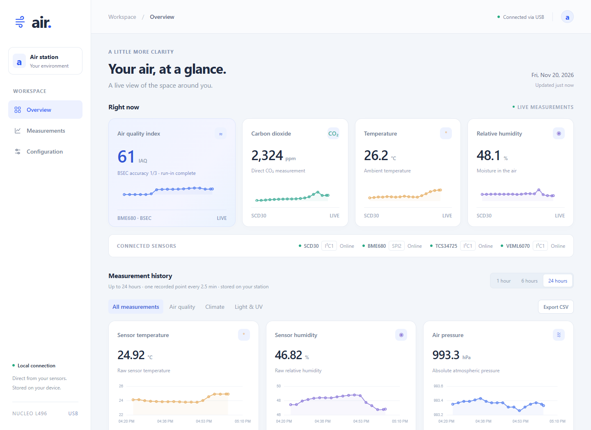
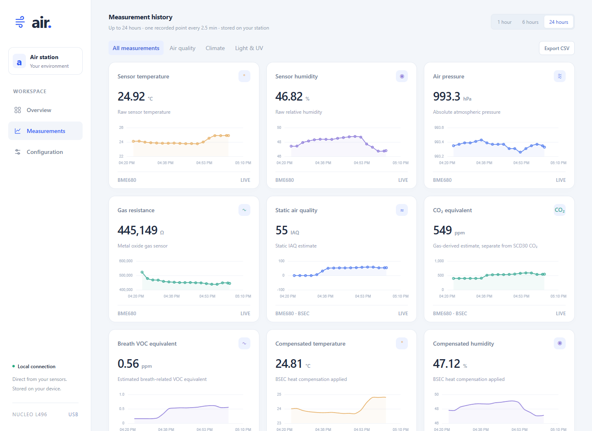
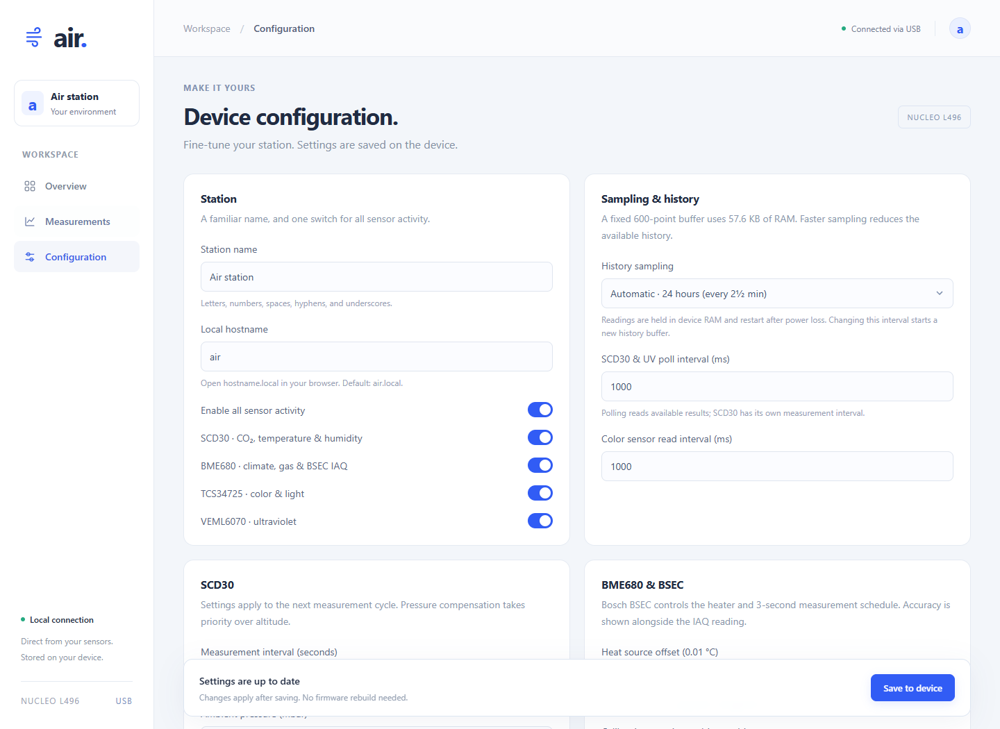
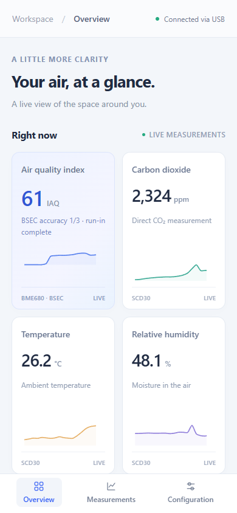

# AirQualitySensors

[](https://github.com/kurta999/AirQualitySensors/actions/workflows/build.yml)

STM32 environmental sensor firmware with a dashboard served directly by the
device. The tested **NUCLEO-L496ZG** setup reads SCD30, BME680, TCS34725, and
VEML6070 sensors, calculates Bosch BSEC indoor air quality, and connects to a PC
as a USB Ethernet adapter. Open **[air.local](http://air.local/)** or
**[192.168.7.1](http://192.168.7.1/)** for live readings, graphs, and configuration.

The original **STM32L476ZG** design remains supported, including its ST7565 LCD,
USB keyboard gateway, HPMA particle sensor, UART output, and optional ESP32 Wi-Fi
transport. [AirQualitySensors.ioc](AirQualitySensors.ioc) describes that original
design; the Nucleo presets select the L496 startup, memory layout, and attached
peripherals. Use the preset matching your board. The existing
[WindowsAddon](https://github.com/kurta999/WindowsAddon) receiver remains compatible.



[Nucleo quick start](#nucleo-usb-quick-start) ·
[Build profiles](#build-profiles) ·
[Dashboard and screenshots](#device-dashboard) ·
[Troubleshooting](#troubleshooting) ·
[Pinout](#pinout-and-hardware-connections)

## Features

- BME680 temperature, humidity, pressure, and raw gas resistance over SPI
- SCD30 CO2, temperature, and humidity over I2C
- VEML6070 raw UV measurement over I2C
- TCS34725 RGB, correlated color temperature, and illuminance over I2C
- Honeywell HPMA115S0 PM2.5 and PM10 parsing over UART
- ST7565 128×64 status display
- USB HID keyboard host with UART forwarding
- Optional ESP32 Wi-Fi/TCP transport, disabled by default
- Optional Bosch BSEC IAQ processing on the Nucleo L496, with persistent calibration state
- USB RNDIS Ethernet with a device-side DHCP server, replacing Wi-Fi on the Nucleo USB profile
- Offline dashboard at the device IP or `air.local`, with 22 measurement/status graphs and CSV export
- Flash-saved sensor switches, sampling, compensation, history, and PC receiver settings
- Up to 24 hours of measurement history in a fixed SRAM2 ring buffer
- TypeScript frontend with locally bundled Chart.js and gzip assets streamed from flash
- FreeRTOS task separation and synchronized measurement snapshots
- Eight CMake build profiles, host/frontend tests, real-board checks, and GitHub Actions CI

## Prerequisites

- CMake 3.20 or newer
- Ninja
- GNU Arm Embedded toolchain (`arm-none-eabi-gcc`, `arm-none-eabi-objcopy`, and related tools)
- Optional: STM32CubeIDE/CubeMX for editing the `.ioc` configuration
- Optional: STM32CubeProgrammer or an IDE debugger for flashing
- PowerShell 7 and the STM32CubeIDE/ST-LINK tools for the supplied Windows debug/network scripts
- Node.js 22 or newer and npm when rebuilding the frontend; firmware-only builds use the checked-in gzip assets
- Installed Google Chrome for the optional browser tests and screenshot capture

The toolchain file searches `PATH` and common STM32CubeIDE installation locations. For a custom installation, set `ARM_TOOLCHAIN_PATH` to the toolchain's `bin` directory:

```powershell
$env:ARM_TOOLCHAIN_PATH = 'C:\path\to\arm-gnu-toolchain\bin'
```

## Nucleo USB quick start

The verified wiring uses **NUCLEO-L496ZG / STM32L496ZGT6**, four sensors, and
two USB data cables. No LCD, particle sensor, keyboard, or ESP32 is required.

| Connection | Nucleo pins / connector | Power in the tested setup |
| --- | --- | --- |
| TCS34725 color sensor | I2C1 SCL **PB8**, SDA **PB9** | 3V3 and GND |
| VEML6070 UV sensor | I2C1 SCL **PB8**, SDA **PB9** | 3V3 and GND |
| SCD30 CO₂ sensor | I2C1 SCL **PB8**, SDA **PB9** | **5V** to the breakout supply input, common GND |
| BME680 | SPI2 SCK **PB10**, SDO/MISO **PC2**, SDI/MOSI **PC3**, CS **PF12** | 3V3 and GND |
| Native USB device connection | **CN13** to the PC with a data cable | USB Ethernet/dashboard |
| ST-LINK connection | Onboard ST-LINK USB connector to the PC | Programming and debugging |

Keep the I2C signal pull-ups at **3.3 V**, including when the SCD30 supply is
5 V. Check the power labels and regulator/level-shifting arrangement of your
particular breakout. The Nucleo presets enable weak internal pull-ups and a
slower bus for bring-up; external pull-ups give more reliable signal edges.

From the repository root, install the pinned BSEC package, then build and flash:

```powershell
./scripts/Install-Bsec.ps1
./scripts/Debug-Nucleo.ps1 -Preset nucleo-usb
```

The debug script finds installed STM32CubeIDE tools, configures/builds the
correct image, flashes it, and opens GDB stopped at startup. At the GDB prompt:

```text
continue
```

Windows should create a **Remote NDIS Compatible Device** adapter and receive
`192.168.7.2/30` automatically. Open [http://air.local/](http://air.local/) or
[http://192.168.7.1/](http://192.168.7.1/). Allow the sensors a few seconds to
start; BSEC accuracy is displayed separately while the algorithm learns.
The page works without a PC receiver application or Internet connection.

Use **Configuration → Save to device** to apply settings and retain them in
flash. The master sensor switch pauses all attached sensors while leaving USB
and the configuration page available. Settings that affect SCD30 restart its
measurement cycle, so its readings briefly show as waiting.

## Build

Configure and build Debug firmware:

```text
cmake --preset debug
cmake --build --preset debug --parallel
```

For the optimized build, replace `debug` with `release`. Each build produces these files under `build/<preset>/`:

- `AirQualitySensors.elf` — debug symbols and executable image
- `AirQualitySensors.hex` — Intel HEX image
- `AirQualitySensors.bin` — raw flash image
- `AirQualitySensors.map` — linker map

The repository also remains importable in STM32CubeIDE. CMake is the reproducible build used by CI and is the recommended command-line path.

### Build profiles

| Preset | MCU | Enabled hardware / purpose |
| --- | --- | --- |
| `nucleo-usb` | STM32L496ZG | Four sensors, BSEC, USB RNDIS/DHCP, mDNS, dashboard, settings, history; Wi-Fi and USB host off |
| `nucleo-bsec` | STM32L496ZG | Four sensors with BSEC and persistent calibration; no USB network |
| `nucleo-sensors` | STM32L496ZG | Three I2C sensors plus raw BME680 on SPI2 |
| `nucleo-i2c` | STM32L496ZG | SCD30, VEML6070, and TCS34725 on PB8/PB9 |
| `hardware-off` | STM32L496ZG | Optional application hardware/tasks disabled; scheduler, SWD, and status LEDs remain |
| `debug` | STM32L476ZG | Original hardware configuration, debug symbols, Wi-Fi off |
| `release` | STM32L476ZG | Optimized original hardware configuration, Wi-Fi off |
| `wifi-check` | STM32L476ZG | Compile-check of the ESP32 path with placeholder credentials; not a deployment profile |

`nucleo-bsec` and `nucleo-usb` require `scripts/Install-Bsec.ps1`. Nucleo
profiles ignore `app_config.local.h` and explicitly select their peripherals.
USB device networking, USB keyboard host mode, and ESP32 Wi-Fi are mutually
exclusive in the USB profile.

## Nucleo with only the I2C sensors

The `nucleo-i2c` preset targets **NUCLEO-L496ZG (STM32L496ZG)** with only
TCS34725, VEML6070, and SCD30 enabled on I2C1: **PB8 = SCL, PB9 = SDA**, common GND,
and a common ground. The tested color/UV breakouts use 3V3, while the SCD30
supply input is connected to Nucleo 5V. External I2C pull-ups to 3V3 are required (often
already fitted on sensor breakout boards).
The bring-up preset sets `APP_I2C1_INTERNAL_PULLUPS=1` as a weak fallback
and `APP_I2C1_TIMING=0x3090F9F9U` (about 20 kHz with the 40 MHz peripheral
clock). This combination was needed for the attached sensors to communicate
on the tested wiring. Use external pull-ups for reliable bus rise times.
The SCD30 uses a 2 s measurement interval and a 250 ms transfer timeout to
allow its specified clock stretching, with a settling delay after start.
The preset enables `APP_SCD30_RECOVERY_ENABLED`: initialization soft-resets
the sensor, waits 2 s, reads its firmware version, stops measurement, sets and
reads back the interval, then restarts. If no sample arrives for the configured
interval × 2 plus 30 s, polling
reports an error so the existing five-failure retry policy reinitializes it.
`scd30_diagnostics` exposes reset/sample counters and command results in GDB.
The initialization also applies the configured temperature offset, altitude,
and automatic self-calibration setting, reading persisted sensor settings first
to avoid unnecessary writes.

```powershell
cmake --preset nucleo-i2c
cmake --build --preset nucleo-i2c --parallel
# Finds the installed STM32CubeIDE tools, builds, flashes, and opens GDB:
./scripts/Debug-Nucleo.ps1
```

In GDB, use `continue`, then Ctrl+C and `sensors` to inspect the measurement
snapshot, I2C error code, and GPIOB input register. `valid_mask = 0x19` means
SCD30, UV, and color have produced data. UV/color `timestamp_ms[3]` and `[4]`
advance about once a second; SCD30 `timestamp_ms[0]` advances about every two
seconds. PB8/PB9 should both read high when the bus is idle
(`GPIOB.IDR & 0x300` equals `0x300`). UV raw zero can be normal indoors; validity
and advancing timestamps distinguish a successful read from a missing device.
Use `./scripts/Debug-Nucleo.ps1 -AttachOnly` to inspect the running firmware
without downloading it again.

To disable all optional hardware, build the `hardware-off` preset, or set
`APP_HARDWARE_ENABLED` to `0` in `Core/Inc/app_config.local.h`. Individually
enable attached devices with `APP_TCS34725_ENABLED=1`,
`APP_VEML6070_ENABLED=1`, and `APP_SCD30_ENABLED=1`. The I2C-only preset supplies
these settings and ignores local overrides. LCD, BME680, HPMA, USB host, host UART,
ADC, I2C3, Wi-Fi, and the watchdog stay off. The scheduler, time base, SWD,
and two onboard indicator LEDs remain available. Disabled tasks are not
registered with the task-health watchdog.

The original `debug`/`release` presets and `.ioc` remain for the original
STM32L476ZG design. `AQS_MCU=STM32L496` selects the separate L496 startup,
device header, and linker layout (1 MB flash, 256 KB SRAM1, 64 KB SRAM2).
`App_HardwareInit()` owns selectable peripheral/pin startup; protected user
blocks bypass CubeMX's full initialization list. After CubeMX regeneration,
keep `app_hardware.c` in the project and use the matching CMake preset.

## Adding the BME680 to the Nucleo test

Use the `nucleo-sensors` preset to enable BME680 on SPI2 alongside the three
I2C sensors, with the remaining hardware disabled:

```powershell
cmake --preset nucleo-sensors
cmake --build --preset nucleo-sensors --parallel
./scripts/Debug-Nucleo.ps1 -Preset nucleo-sensors
```

Wire SCK to PB10, SDO/MISO to PC2, SDI/MOSI to PC3, and CS to PF12,
with common ground and power appropriate for the sensor breakout. The GDB
`sensors` command also prints `bme680_diagnostics`, including chip ID,
initialization result, SPI error code, and sample count. A BME680 chip ID is
`0x61`; all four sensors producing samples sets `measurements.valid_mask`
to `0x1B`. If BME680 cannot initialize, the other sensors keep running and
the BME680 is retried about once a second.

## Bosch BSEC indoor air quality on the Nucleo

The `nucleo-bsec` preset runs Bosch BSEC **2.6.1.0** on the STM32L496 together
with all four connected sensors. Install the pinned official package locally:

```powershell
./scripts/Install-Bsec.ps1
cmake --preset nucleo-bsec
cmake --build --preset nucleo-bsec --parallel
./scripts/Debug-Nucleo.ps1 -Preset nucleo-bsec
```

The installer verifies SHA-256 hashes and preserves Bosch's license notices.
The package remains in the ignored `libs/bsec/` directory; it is not part of
the project's MIT license. The firmware links the Cortex-M4F GCC hard-float
archive and the BME680 3.3 V, 3 s, four-day-history configuration. BSEC controls
oversampling, heater temperature/duration, and measurement timing. Raw sensor
profiles are available through the other presets.

In GDB, Ctrl+C and `sensors` shows `bsec_diagnostics` and
`measurements.air_quality`, including IAQ (0–500), accuracy (0–3), stabilization,
run-in, static IAQ, estimated CO2/VOC equivalents, and heat-compensated
temperature/humidity. A new result arrives about every 3 s. Accuracy **0** means
run-in/calibration is incomplete; an IAQ value with accuracy 0 is provisional.
Let the board run continuously in representative air
conditions. The SCD30 continues providing the independently measured CO2 value.
The BSEC CO2-equivalent output is a gas-based estimate. `APP_BSEC_HEAT_SOURCE_C`
(default 0) permits a measured, device-specific additional temperature offset.

The legacy `MEAS_DATA` record retains its field order and meaning. IAQ is added
to the synchronized in-memory snapshot with its own validity/timestamp, not
inserted into the positional UART/TCP record. With all four sensors and IAQ
producing data, `valid_mask` is `0x3B`. A present IAQ value still needs its
accuracy/run-in flags checked before use.

BSEC state is saved when accuracy improves, then every 6 h while accuracy is
nonzero. Two 4 KiB slots at `0x080FE000` and `0x080FF000` alternate records with
sequence numbers, CRC-32, configuration/version identification, and a final
commit marker. The L496 linker reserves the last **16 KiB** in every preset:
8 KiB for dashboard settings, followed by these 8 KiB for BSEC state.
Ordinary firmware downloads preserve both; a chip mass erase removes them.
Storage checks the 1 MiB dual-bank, unswapped flash layout before erasing. A
debugger can set `bsec_diagnostics.save_requested=1` to request a one-off save
through the running task; normal operation requires no debugger interaction.
Restore/save status and counters are exposed in `bsec_diagnostics`.

## USB RNDIS network instead of Wi-Fi

The `nucleo-usb` preset keeps all four sensors and BSEC enabled and replaces
Wi-Fi and USB host mode with a USB **device** network interface. Connect a
data cable from native USB **CN13** to the PC; keep the ST-LINK cable connected
for programming/debugging. PG6 keeps the board's USB host VBUS power switch
off in this mode. TinyUSB owns the USB interrupt and device endpoints; the
original CubeMX `.ioc` host configuration remains available to the older
profiles and is bypassed by the protected application initialization path.

```powershell
./scripts/Install-Bsec.ps1
cmake --preset nucleo-usb
cmake --build --preset nucleo-usb --parallel
./scripts/Debug-Nucleo.ps1 -Preset nucleo-usb
```

Windows automatically binds its built-in Remote NDIS Compatible Device
driver using the firmware's Microsoft OS descriptors. This development
firmware uses TinyUSB's example VID with a dedicated product ID; assign
proper product identifiers before distributing hardware. The device serial
and locally administered MAC address derive from the MCU unique ID.

| Endpoint | Value |
| --- | --- |
| Board address | `192.168.7.1/30` |
| PC address, assigned by the board's DHCP server | `192.168.7.2/30` |
| DHCP lease | 24 h, one USB host |
| Default gateway / DNS supplied to PC | None |
| Live dashboard and configuration | `http://air.local/` or `http://192.168.7.1/` |
| JSON snapshot, validity, timestamps and IAQ status | `http://192.168.7.1/api/measurements` |
| Existing positional record | `http://192.168.7.1/measurements` |
| Configuration / history | `/api/config`, `/api/history?after=0` |
| Default measurement push destination | PC `192.168.7.2:2005`, editable in Configuration |

The board sends the existing `MEAS_DATA` record every
`APP_MEASUREMENT_SEND_INTERVAL_MS` (default 1500 ms). It supports both a
persistent TCP receiver and the current PC receiver that closes after one
record. Port 80 also accepts the existing exact `SEND_SENSOR_DATA` command
to request an immediate push. Configuration uses same-origin HTTP POSTs;
see [Dashboard and settings](docs/dashboard.md).
IP forwarding is disabled and the board does not advertise a default route
or DNS server, so the PC's existing network connections continue providing
Internet access. The `192.168.7.0/30` subnet must be free on the PC.

To repeat the Windows acceptance test while the companion TCP receiver is
listening on port 2005:

```powershell
./scripts/Test-UsbNetwork.ps1 -RequireReceiver
```

This PowerShell 7 script verifies a DHCP lease, no USB default gateway/DNS,
ping, repeated HTTP requests, advancing sensor timestamps, and acknowledged
TCP measurement bytes. It writes `build/nucleo-usb/pc-test.json`.
Without `-RequireReceiver`, HTTP/network checks still run when no companion
receiver is installed. In GDB, `sensors` includes `usb_net_diagnostics`;
packet, DHCP, HTTP, record-send and TCP acknowledgment counters are available.
The USB stack is confined to one FreeRTOS task and uses bounded packet and
HTTP buffers. The original raw/BSEC presets remain available.

## Device dashboard

Open **http://air.local/** or **http://192.168.7.1/** from the connected PC.
The responsive TypeScript dashboard includes Chart.js graphs for every available
measurement, BSEC accuracy/run-in status, 1/6/24-hour views, and CSV export.
It works without Internet access or a CDN. Configuration controls the master
sensor switch, individual sensors, polling, SCD30 compensation/calibration,
BSEC heat offset/state-save interval, color/UV integration, history, and the
PC receiver. Save explicitly writes verified settings to flash and applies them.
Build-time MCU/peripheral capabilities and the direct USB subnet remain fixed.

### Screenshots

These are captures from the running Nucleo with real sensor readings. Values,
history length, and BSEC accuracy depend on the environment and device uptime.
The overview is shown at the top of this README.

**Measurement history:** each measurement has its own graph, with category
filters, a selectable time window, and CSV export.



**Configuration:** sensor controls, sampling/history, compensation, and receiver
settings are saved explicitly to the device.



<details>
<summary>Mobile overview</summary>



</details>

### Runtime settings and defaults

| Configuration group | Default behavior |
| --- | --- |
| Station and sensors | Hostname `air.local`, label `Air station`, all four attached sensors enabled |
| SCD30 | 2 s measurement interval, 1 s polling, pressure/temperature/altitude offsets 0, automatic self-calibration and recovery enabled |
| BME680/BSEC | BSEC-managed 3 s schedule, extra heat offset 0 °C, calibration saved on accuracy improvement and every 6 h while accuracy is nonzero |
| TCS34725 | 4× gain, 21 integration cycles (about 50 ms), 1 s read interval |
| VEML6070 | 4T integration, 1 s polling; readings are raw UV counts |
| PC receiver | Enabled, `192.168.7.2:2005`, one legacy measurement record every 1500 ms |
| History | Automatic 150 s sampling, up to 24 h, 600-record RAM budget |

The exact ranges and API field names are in [docs/dashboard.md](docs/dashboard.md).
Offsets shown in hundredths of a degree use `100 = 1.00 °C`. Sensor switches
stop measurement activity and invalidate current readings. They do not remove
the compiled drivers or change physical pin assignments.

### History and persistence

History uses **57,600 bytes of SRAM2**, holding 600 records with all 21 values
and BSEC status. Automatic sampling records every 150 seconds for up to 24 h;
faster selectable intervals reduce retention. History restarts on power loss
or interval changes. Settings and BSEC calibration survive ordinary reflashing.
The gzip dashboard is streamed from flash; it is never decompressed in MCU RAM.

The browser refreshes live measurements about every 2 s and overlays the latest
reading between recorded history points. The 1/6/24-hour controls select the
display window; **History sampling** controls the device's recording interval.
Closing the browser does not stop recording. Restarting the MCU or changing
the history interval starts a new history buffer.

| Recording interval | Maximum retained history |
| --- | --- |
| Automatic / 150 s | 24 h |
| 60 s | About 10 h |
| 30 s | About 5 h |
| 15 s | About 2.5 h |
| 5 s | About 50 min |
| 5 min or slower | Up to 24 h, with fewer points |

Missing/stale measurements appear as gaps. SCD30 CO₂ is measured independently;
BSEC CO₂-equivalent and VOC-equivalent are estimates. BSEC accuracy 0 means the
algorithm is still learning. VEML6070 raw counts are not a calibrated UV index.

Settings use alternating flash records with sequence numbers, CRC32, and a
final commit marker. Settings occupy `0x080FC000`/`0x080FD000`; BSEC calibration
occupies `0x080FE000`/`0x080FF000`. An interrupted settings save can retain the
previous valid record. Unchanged settings do not trigger another flash erase.
History is held in RAM and is not written to those flash slots.

### Memory budget

Measured for the tested `nucleo-usb` build; sizes change as firmware evolves.
Configuration and `/api/config` expose the current image and RAM reservations.

| Allocation | Size | Location / available space |
| --- | --- | --- |
| Complete firmware image | 293,584 bytes (about 287 KiB) | Flash; 1008 KiB available after persistence reservations |
| Gzip HTML, JavaScript, CSS, and licenses | 71,871 bytes (about 70 KiB), included in the image above | Flash; build enforces a 110 KiB gzip budget |
| Main static RAM | 137,180 bytes (about 134 KiB) | SRAM1, 256 KiB total; includes the RTOS heap/stacks and network buffers |
| History ring | 57,600 bytes (600 × 96) | SRAM2, 64 KiB total |
| Settings + BSEC slots | 16 KiB | Reserved flash, separate from the firmware image |

Chart.js runs on the PC/browser. The MCU streams compressed assets directly
from flash and exports history in small pages; neither the full uncompressed
page nor a day's JSON response is allocated in device RAM.

### Rebuilding the webpage

To rebuild the checked-in firmware assets after changing `web/src/`:

```powershell
cd web
npm ci
npm run build
npm test
cd ..
cmake --build --preset nucleo-usb --parallel
```

`web/build.mjs` type-checks through the npm script, bundles only the Chart.js
components used, gzips the assets, and generates `Core/Src/web_assets.c`.
Firmware-only builds use that checked-in C file without requiring Node.
Commit `Core/Src/web_assets.c` alongside frontend edits so the next firmware
build includes the updated page. `web/dist/manifest.json` lists the gzip sizes
and hashes; `web/dist/` and `web/node_modules/` are ignored build/dependency files.
See [docs/dashboard.md](docs/dashboard.md) for memory/layout details, API
contracts, build checks, and the real-board browser test.

To refresh the README screenshots from a running board without saving or
changing any device settings:

```powershell
node web/capture-screenshots.mjs
```

This uses installed Chrome and writes `docs/screenshots/`. Set
`$env:AIR_DEVICE_URL = 'http://192.168.7.1'` to capture through the IP address
instead of the default `http://air.local`.

## Backend

Measurements are received by [WindowsAddon](https://github.com/kurta999/WindowsAddon), a Windows tray toolbox that also serves as the sensor backend for this firmware. It runs the TCP server the device reports to, stores the average of the measurements in a configured integration period in an SQLite database, and generates graphs from recent measurements plus daily and weekly averages. The graphs are served at `your_local_ip:2005/graphs` and can be viewed from any device on the network, including a phone.

On `nucleo-usb`, set the receiver address/port and reporting interval in the
dashboard's **Configuration → PC receiver** section. The default USB destination
is `192.168.7.2:2005`. The original UART/Wi-Fi profiles use `APP_SERVER_ADDRESS`
and `APP_SERVER_PORT`; their USART2 link can also feed the backend. The embedded
dashboard operates independently of the backend and its SQLite storage.

The record is a shared wire format documented in [docs/protocol.md](docs/protocol.md). The receiver reads its values positionally, so changing the order, count or spacing of the fields breaks the backend even though the firmware still builds. The host test suite pins the exact record to catch that.

## Local configuration and Wi-Fi

The committed defaults in [app_config.h](Core/Inc/app_config.h) disable Wi-Fi and contain no deployment credentials. To enable it:

1. Copy `Core/Inc/app_config.local.example.h` to `Core/Inc/app_config.local.h`.
2. Set the SSID, password, server address, and port in the local file.
3. Reconfigure and rebuild the firmware.

`app_config.local.h` is ignored by Git. Never commit real credentials. Wi-Fi transport is plain TCP, so use it only on a trusted network or put an authenticated, encrypted gateway in front of the device. Remote reset commands remain disabled unless explicitly enabled.

These macros select compiled capabilities or supply initial defaults. On the
USB profile, saved runtime settings take precedence for user-facing sensor and
receiver options. Use the webpage to change an existing saved configuration.
The original Wi-Fi profile still requires rebuilding for credentials/transport.

Available configuration macros:

| Macro | Safe default | Purpose |
| --- | --- | --- |
| `APP_HARDWARE_ENABLED` | `1` | Master build-time default for optional hardware; minimal Nucleo profiles set it to 0 and explicitly enable attached devices |
| `APP_SCD30_ENABLED`, `APP_BME680_ENABLED`, `APP_TCS34725_ENABLED`, `APP_VEML6070_ENABLED` | Master hardware default | Include the attached sensor drivers/tasks |
| `APP_HPMA_ENABLED`, `APP_LCD_ENABLED`, `APP_HOST_UART_ENABLED`, `APP_ADC_ENABLED`, `APP_I2C3_ENABLED`, `APP_WATCHDOG_ENABLED` | Master hardware default | Select optional original-board peripherals |
| `APP_BSEC_ENABLED` | `0` | Link BSEC; requires BME680 and the installed Bosch package |
| `APP_BSEC_HEAT_SOURCE_C` / `APP_BSEC_STATE_SAVE_INTERVAL_MS` | `0.0` / `21600000` | Initial BSEC heat offset and calibration-save interval |
| `APP_USB_RNDIS_ENABLED` | `0` | Include USB Ethernet/DHCP/dashboard; enabled by `nucleo-usb` |
| `APP_USB_HOST_ENABLED` | Master hardware default | USB keyboard host; disabled in the USB device profile |
| `APP_I2C1_INTERNAL_PULLUPS` / `APP_I2C1_TIMING` | `0` / `0x00909BEB` | Build-time bus setup; Nucleo profiles select `1` / `0x3090F9F9` |
| `APP_WIFI_ENABLED` | `0` | Build and start Wi-Fi tasks |
| `APP_WIFI_SSID` / `APP_WIFI_PASSWORD` | empty | Access-point credentials |
| `APP_SERVER_ADDRESS` | `192.0.2.1` | Measurement receiver address |
| `APP_SERVER_PORT` | `2005` | Measurement receiver port |
| `APP_ALLOW_REMOTE_RESET` | `0` | Accept the ESP32 `RESET` command |
| `APP_MEASUREMENT_SEND_INTERVAL_MS` | `1500` | UART/Wi-Fi reporting interval |
| `APP_SCD30_AMBIENT_PRESSURE_MBAR` | `0` | SCD30 pressure compensation; `0` disables it |
| `APP_SCD30_RECOVERY_ENABLED` | `0` | Initial soft-reset/stall-recovery setting; Nucleo profiles enable it |

## Tests

The host suite tests the platform-independent protocol and parsers:

```text
cmake -S tests -B build/host-tests -G Ninja -DCMAKE_BUILD_TYPE=Debug
cmake --build build/host-tests --parallel
ctest --test-dir build/host-tests --output-on-failure
```

The host suite also covers settings validation, HTTP framing/origin checks,
flash record corruption/interrupted writes, history pagination/retention/tick
wrap, sensor retry, and task-health behavior. Frontend decoder tests run with
`npm test` in `web/`.

GitHub Actions runs the host tests, the dashboard type-check/build/size checks
and decoder tests, and **all eight firmware presets** on pushes and pull
requests. `wifi-check` compiles the ESP32 path with placeholder credentials.
CI does not replace physical sensor or network testing.

For the attached Nucleo and PC:

```powershell
./scripts/Test-UsbNetwork.ps1 -RequireReceiver
node web/test-device.mjs
node web/test-http.mjs
# After checking persistence across an MCU reset, restore the original intervals:
node web/test-device.mjs --restore
```

The USB check waits up to 20 s for fresh readings and verifies DHCP, ping,
HTTP, advancing measurements, and receiver acknowledgements. Omit
`-RequireReceiver` if no PC receiver is running. The browser test temporarily
selects 5 s history and 2 s reporting and exercises save/disable/resume;
the HTTP test temporarily changes hostname/sensor settings and restores them.
Reports/test screenshots are written to ignored `build/nucleo-usb/`.
README screenshots use the separate read-only capture command above.

## Architecture

```text
 sensor tasks / optional HPMA ISR
                  │
                  ▼
       synchronized MeasurementSnapshot
          ┌───────┼───────────────────────┐
          ▼       ▼                       ▼
    optional   legacy text          USB network task
    ST7565 UI  formatter            ├─ DHCP + mDNS
                  │                 ├─ HTTP live API
        UART2 / ESP32 / USB TCP     ├─ SRAM2 history ring
                  │                 ├─ flash-saved settings
                  ▼                 └─ gzip dashboard in flash
           WindowsAddon                       │
         (SQLite + graphs)                    ▼
                                   browser / local Chart.js
```

Application code is under `Core/`, reusable drivers are under `libs/`, generated STM32 and USB support is under `Drivers/`, `Middlewares/`, and `USB_HOST/`, and build logic is under `cmake/`. See [docs/protocol.md](docs/protocol.md) for wire formats.

## Flashing and debugging

Flash `build/<matching-preset>/AirQualitySensors.elf`, `.hex`, or `.bin` with
STM32CubeProgrammer or ST-LINK. For the current USB setup, use `nucleo-usb`;
`build/debug/` targets the original L476 board. The VS Code launch configuration
expects the STM32 embedded tools extension and a local ST-LINK GDB server.

```powershell
./scripts/Debug-Nucleo.ps1 -Preset nucleo-usb -AttachOnly
```

`-AttachOnly` inspects the running firmware without downloading it again.
In GDB, Ctrl+C pauses execution, `sensors` prints snapshots/diagnostics, and
`continue` resumes. While the core is halted, USB networking and sensor tasks
are halted too. Ordinary sector-based ELF/HEX downloads preserve the reserved
settings/BSEC slots; avoid a full-chip erase when preserving those records. Do not use an image
built for another MCU/startup/linker layout.

## Troubleshooting

| Symptom | Check |
| --- | --- |
| No USB Ethernet adapter | Use a data cable on **CN13**, keep the ST-LINK cable for debugging, and flash `nucleo-usb`. The original USB-host profile does not expose a network adapter. |
| IP address does not open | Check that the PC adapter received `192.168.7.2/30`, the subnet is not already in use, and GDB is running with `continue`. The device is `192.168.7.1`. |
| `air.local` does not resolve | Try the IP URL first. mDNS is separate from DHCP DNS settings; the USB interface intentionally has no DNS server. A renamed hostname can take time to leave the PC resolver cache. |
| SCD30 reads as waiting | Verify supply/common ground and PB8/PB9, enable it in Configuration, and allow its restart/measurement cycle to finish after changing settings. Check `scd30_diagnostics` if it stays stalled. |
| BME680 is missing | Recheck **SCK → PB10**, SDO/MISO → PC2, SDI/MOSI → PC3, CS → PF12. Its chip ID is `0x61`; GDB exposes SPI/init/sample diagnostics. |
| UV reads zero indoors | Zero can be a valid raw reading. Check the online state and advancing source timestamp before treating it as a fault. |
| IAQ is 0/50 or accuracy is 0 | Read accuracy, stabilization, and run-in status. A fresh BSEC output can still be provisional; it is separate from the measured SCD30 CO₂ reading. |
| Few graph points / history disappeared | Automatic recording is every 150 s. A restart or interval change clears RAM history; selecting a faster interval reduces retention. Closing the browser does not clear it. |
| PC receiver is disconnected | Verify the dashboard receiver address/port, that the PC application listens there, and that its traffic is allowed. Dashboard access works independently of that receiver. |

## Contributing and security

Read [CONTRIBUTING.md](CONTRIBUTING.md) before opening a pull request. Security-sensitive reports belong in the process described by [SECURITY.md](SECURITY.md), not in public issues.

## License

Project-authored code is released under the [MIT License](LICENSE). Bundled vendor and third-party components retain their own terms; see [THIRD_PARTY_NOTICES.md](THIRD_PARTY_NOTICES.md) and the license files next to those components.

## Pinout and hardware connections

The tables below are the original-board wiring reference, with Nucleo/USB
overrides called out where relevant. Assignments come from
[AirQualitySensors.ioc](AirQualitySensors.ioc), generated `Core/Src/` peripheral
code, and the pin labels in [Core/Inc/main.h](Core/Inc/main.h). Enabled
peripherals are selected by [app_hardware.c](Core/Src/app_hardware.c), the
matching build preset, and protected initialization overrides. A listed pin
does not mean that peripheral is active in every profile.

Target: **STM32L476ZGTx**, Cortex-M4F, LQFP144, 42 pins configured. Confirm voltage levels, pull-ups, sensor addresses and power requirements against each component's datasheet before connecting hardware.

### Quick reference

| Function | Peripheral | MCU pins |
| --- | --- | --- |
| SCD30, VEML6070, TCS34725 | I2C1 | PB8 SCL, PB9 SDA |
| BME680 | SPI2 | PB10 SCK, PC2 MISO, PC3 MOSI, PF12 CS |
| ST7565 LCD | SPI1 (half-duplex) | PE13 SCK, PA7 MOSI, PB15 CS, PB13 RESET, PB12 A0, PC9 backlight PWM |
| HPMA115S0 | UART4 | PA0 TX, PA1 RX |
| ESP32 AT module | USART3 + DMA | PC4 TX, PC5 RX, PC1 enable |
| Keyboard / measurement gateway UART | USART2 | PA2 TX, PA3 RX |
| USB HID host | USB OTG FS | PA11 DM, PA12 DP, PG6 VBUS enable |
| USB RNDIS device (`nucleo-usb`) | USB OTG FS / CN13 | PA11 DM, PA12 DP, PA9 VBUS sense; PG6 held low |
| Spare I2C | I2C3 | PC0 SCL, PG8 SDA |
| Analog input | ADC1_IN16 | PB1 |
| Indicator LEDs | GPIO | PC7, PB7, PB14, PD4–PD7 |
| Debug | SWD/SWO | PA13 SWDIO, PA14 SWCLK, PB3 SWO |

### Complete pin map

| Pin | Signal | AF | Mode | Label in code | Used for |
| --- | --- | --- | --- | --- | --- |
| PA0 | UART4_TX | AF8 | Push-pull AF, very high speed | — | HPMA115S0 particle sensor command line |
| PA1 | UART4_RX | AF8 | Push-pull AF, very high speed | — | HPMA115S0 measurement frames |
| PA2 | USART2_TX | AF7 | Push-pull AF, very high speed | `UART_KBD_TX` | Keystroke + measurement records to the host |
| PA3 | USART2_RX | AF7 | Push-pull AF, very high speed | `UART_KBD_RX` | Host link (receive side) |
| PA7 | SPI1_MOSI | AF5 | Push-pull AF, very high speed | — | ST7565 LCD data (half-duplex, no MISO) |
| PA9 | USB VBUS sense | — | Input in USB device mode | — | CN13 host power detection in `nucleo-usb` |
| PA11 | USB_OTG_FS_DM | AF10 | Push-pull AF | — | USB D−; HID host or RNDIS device, depending on preset |
| PA12 | USB_OTG_FS_DP | AF10 | Push-pull AF | — | USB D+; HID host or RNDIS device, depending on preset |
| PA13 | SYS_JTMS-SWDIO | — | Trace async SW | — | SWD debug |
| PA14 | SYS_JTCK-SWCLK | — | Trace async SW | — | SWD debug |
| PB1 | ADC1_IN16 | — | `GPIO_MODE_ANALOG_ADC_CONTROL` | — | Analog input, rank 1 of the ADC sequence (see [ADC1](#adc1-pb1)) |
| PB3 | SYS_JTDO-SWO | — | Trace async SW | — | SWO trace; `printf`/`ITM_SendChar` output |
| PB7 | GPIO output | — | Push-pull, no pull, low speed | `ULED_2` | Startup blink in `main()` |
| PB8 | I2C1_SCL | AF4 | Open-drain AF; weak internal pull-up in Nucleo profiles | — | Sensor I2C clock |
| PB9 | I2C1_SDA | AF4 | Open-drain AF; weak internal pull-up in Nucleo profiles | — | Sensor I2C data |
| PB10 | SPI2_SCK | AF5 | Push-pull AF, very high speed | — | BME680 clock |
| PB12 | GPIO output | — | Push-pull, no pull, low speed | `LCD_A0` | ST7565 data/command select |
| PB13 | GPIO output | — | Push-pull, no pull, low speed | `LCD_RES` | ST7565 reset |
| PB14 | GPIO output | — | Push-pull, no pull, low speed | `ULED_3` | Wi-Fi send heartbeat and `Error_Handler()` blink |
| PB15 | GPIO output | — | Push-pull, no pull, low speed | `LCD_CS` | ST7565 chip select (software driven) |
| PC0 | I2C3_SCL | AF4 | Open-drain AF, very high speed | — | Spare I2C bus (initialised, no driver) |
| PC1 | GPIO output | — | Push-pull, no pull, low speed | `WIFI_EN` | ESP32 enable line |
| PC2 | SPI2_MISO | AF5 | Push-pull AF, very high speed | — | BME680 data out |
| PC3 | SPI2_MOSI | AF5 | Push-pull AF, very high speed | — | BME680 data in |
| PC4 | USART3_TX | AF7 | Push-pull AF, very high speed | — | ESP32 AT commands |
| PC5 | USART3_RX | AF7 | Push-pull AF, very high speed | — | ESP32 AT responses (DMA) |
| PC7 | GPIO output | — | Push-pull, no pull, low speed | `ULED_1` | Reserved indicator, driven low at init |
| PC9 | TIM3_CH4 | AF2 | Push-pull AF, low speed | `LCD_PWN` | LCD backlight PWM |
| PD4 | GPIO output | — | Push-pull, no pull, low speed | `LED_1` | Reserved indicator, driven low at init |
| PD5 | GPIO output | — | Push-pull, no pull, low speed | `LED_2` | Reserved indicator, driven low at init |
| PD6 | GPIO output | — | Push-pull, no pull, low speed | `LED_3` | Reserved indicator, driven low at init |
| PD7 | GPIO output | — | Push-pull, no pull, low speed | `LED_4` | Reserved indicator, driven low at init |
| PE13 | SPI1_SCK | AF5 | Push-pull AF, very high speed | — | ST7565 LCD clock |
| PF12 | GPIO output | — | Push-pull, no pull, low speed | `SPI2_CS` | BME680 chip select (software driven) |
| PG6 | GPIO output | — | Push-pull, no pull, low speed | `USB_EN` | USB VBUS charge-pump enable |
| PG8 | I2C3_SDA | AF4 | Open-drain AF, very high speed | — | Spare I2C bus (initialised, no driver) |

Port G is powered from VDDIO2, so `MX_GPIO_Init()` calls `HAL_PWREx_EnableVddIO2()` before configuring PG6 and PG8. Without that call both pins stay dead.

### I2C1 — sensor bus (PB8 SCL, PB9 SDA)

- Original timing word `0x00909BEB`; Nucleo profiles override it with `0x3090F9F9` (about 20 kHz). Addressing is 7-bit, analog filter enabled, digital filter 0, clock stretching enabled.
- Original pins use `GPIO_NOPULL`; Nucleo profiles enable weak internal pull-ups. Fit external pull-ups to **3V3** for reliable edges, even when SCD30 supply is 5V.
- Three devices share the bus:

| Device | 7-bit address | Driver | Notes |
| --- | --- | --- | --- |
| SCD30 (CO2 / temperature / humidity) | `0x61` | `Core/Src/scd_sensor.c` + `libs/scd30` | Default 2 s measurement interval; readiness polled via `scd30_get_data_ready()`; configurable on USB profile |
| VEML6070 (UV) | `0x38` low byte, `0x39` high byte, `0x0C` ARA | `Core/Src/uv_sensor.c` | Default 4T integration, configurable on USB profile; ARA read clears a pending alert |
| TCS34725 (RGB / lux / colour temperature) | `0x29` | `Core/Src/light_sensor.c` | Default about 50 ms integration and 4× gain, configurable on USB profile; ID accepts `0x4D`, `0x44`, `0x10` |

Because the SCD30 and VEML6070 are serviced by `SensorsTask` while the TCS34725 is serviced by the lower-priority `SensorsBme680Task`, all bus access goes through the mutex in [`Core/Src/i2c_bus.c`](Core/Src/i2c_bus.c) (`I2cBus_Lock()` / `I2cBus_Unlock()`, 1000 ms timeout). The lock is taken around a whole sensor operation, never around individual HAL calls, and it is not recursive.

### I2C3 — spare bus (PC0 SCL, PG8 SDA)

The original configuration initializes `MX_I2C3_Init()` through
`App_HardwareInit()` when `APP_I2C3_ENABLED` is set. No driver uses `hi2c3`, and
minimal Nucleo profiles leave it disabled. It needs external pull-ups when used.

### SPI1 — ST7565 LCD (PE13 SCK, PA7 MOSI)

- Master, **half-duplex (`SPI_DIRECTION_1LINE`)** — the display has no MISO connection.
- CPOL low, CPHA 1-edge (SPI mode 0), MSB first, 8-bit, baud prescaler 2, software NSS.
- `SPI1_IRQn` enabled at preemption priority 5.
- Control pins driven by the driver, not by the SPI peripheral:

| Pin | Label | Role |
| --- | --- | --- |
| PB15 | `LCD_CS` | Chip select |
| PB13 | `LCD_RES` | Hardware reset |
| PB12 | `LCD_A0` | Data / command select |
| PC9 | `LCD_PWN` | Backlight, TIM3_CH4 PWM |

`UI_Init()` in [`Core/Src/user_interface.c`](Core/Src/user_interface.c) passes these to `ST7565_Init()` together with contrast `35` and direction `0` (not flipped), then starts TIM3 CH4 and sets the compare value to `255` (full backlight). Display access is serialised with `lcd_mutexHandle`.

### SPI2 — BME680 (PB10 SCK, PC2 MISO, PC3 MOSI, PF12 CS)

- Master, full-duplex, CPOL low / CPHA 1-edge (SPI mode 0), MSB first, 8-bit, baud prescaler 8, software NSS with `NSSPMode = SPI_NSS_PULSE_ENABLE`.
- **CS is a plain GPIO**: `SensorsBme680Task()` drives `SPI2_CS_Pin` (PF12) high at task start, then low around each register read/write in `sensor_spi_read()` / `sensor_spi_write()`, with 350 ms HAL timeouts.
- Raw-mode settings: humidity ×2, pressure ×4, temperature ×8 oversampling, IIR filter size 3, gas heater 320 °C for 150 ms, forced mode. The loop period follows `bme680_get_profile_dur()`, clamped to a 50 ms floor and falling back to 1000 ms while the sensor has not initialised.
- On `nucleo-bsec`/`nucleo-usb`, BSEC selects oversampling/heater settings and schedules a measurement about every 3 s. Its service runs every 50 ms; the color sensor is polled independently at its configured interval.

### UART4 — Honeywell HPMA115S0 (PA0 TX, PA1 RX)

- **9600 baud**, 8N1, no flow control, 16× oversampling.
- `UART4_IRQn` at preemption priority 5; reception is interrupt-driven one byte at a time (`HAL_UART_Receive_IT`) and fed into the frame parser in `libs/hpma/hpma_parser.c`.
- `Honeywell_Init()` sends `68 01 40 57` (enable auto-send) and `68 01 01 96` (start measurement).
- `Honeywell_Poll()` rearms reception after HAL aborts it on overrun/noise/framing errors, and fully reinitialises the sensor after `HONEYWELL_SILENCE_TIMEOUT_MS` (10 s) without a decoded frame. A missing particle sensor never blocks the rest of the system.

### USART2 — host / keyboard gateway (PA2 TX, PA3 RX)

- **921600 baud**, 8N1, no flow control. `USART2_IRQn` at preemption priority 5.
- Carries two things from `StartDefaultTask()`: USB HID keyboard reports (CRC-16 appended, see `Protocol_Crc16`) and the periodic measurement record described in [docs/protocol.md](docs/protocol.md), sent every `APP_MEASUREMENT_SEND_INTERVAL_MS`.

### USART3 — ESP32 AT module (PC4 TX, PC5 RX, PC1 enable)

- Configured with the **LL** driver, not HAL: 115200 baud, 8N1, one-bit sampling enabled, overrun detection disabled, DMA-deactivate-on-RX-error disabled.
- Clock source PCLK1. `USART3_IRQn` at preemption priority 5.
- DMA (see the [DMA map](#dma-and-interrupt-map)): RX on DMA1 channel 3, circular, byte-aligned; TX on DMA1 channel 2, normal mode. RX circular buffer is 4096 bytes (`ESP32_RX_CIRCULAT_BUF_SIZE`).
- `Wifi_Init()` passes `WIFI_EN_GPIO_Port` / `WIFI_EN_Pin` (PC1) as the enable line and **NULL for the reset line** — no ESP32 reset pin is wired. `wifi_setup()` drives PC1 low before issuing a software reset.
- The whole Wi-Fi path, including these pins, is compiled out unless `APP_WIFI_ENABLED` is `1`.

### USB OTG FS host (PA11 DM, PA12 DP, PG6 VBUS enable)

- PA11/PA12 on AF10, `OTG_FS_IRQn` at preemption priority 5, HID host class.
- `MX_DriverVbusFS()` in [`USB_HOST/Target/usbh_platform.c`](USB_HOST/Target/usbh_platform.c) switches VBUS through PG6: state `1` sets the pin, state `0` clears it. Match this against the polarity of your charge pump before powering a device.

### USB OTG FS device — RNDIS dashboard (CN13)

The `nucleo-usb` profile uses the same PA11/PA12 data pins in device mode, PA9
as VBUS sense, and keeps PG6 low. TinyUSB owns the OTG interrupt and endpoints;
the generated host handler is bypassed. USB uses **HSI48 with CRS synchronized
to USB frames**, while the system runs at 40 MHz. One FreeRTOS network task
owns TinyUSB and lwIP, including DHCP, mDNS, HTTP, and the PC measurement stream.

### ADC1 (PB1)

Three-channel scan, 12-bit, right-aligned, continuous, with 256× oversampling and an 8-bit right shift, sampling time 640.5 cycles per channel, clocked from PLLSAI1:

| Rank | Channel | Source |
| --- | --- | --- |
| 1 | `ADC_CHANNEL_16` | PB1 |
| 2 | `ADC_CHANNEL_TEMPSENSOR` | Internal die temperature |
| 3 | `ADC_CHANNEL_VREFINT` | Internal reference |

Results land in `adc_dma_buf[3]` over DMA1 channel 1 in circular mode. Note that `StartDmaConversion()` is defined in `Core/Src/adc.c` but is **not called anywhere**, so the ADC is initialised and idle — PB1 is reserved rather than actively sampled.

### Timers

| Timer | Configuration | Purpose |
| --- | --- | --- |
| TIM3 CH4 | Prescaler 1, period 255, PWM on PC9 (AF2) | LCD backlight; duty set to 255 in `UI_Init()` |
| TIM16 | Prescaler 40000, period 9 → 10 ms tick, `TIM1_UP_TIM16_IRQn` priority 5 | Drives `Wifi_10MsIsr()`; started only when Wi-Fi is enabled |
| TIM17 | HAL time base (`SYS_VS_tim17`) | `HAL_IncTick()` and `Wifi_SysTick()` |

### Watchdog

IWDG with prescaler 32 and reload/window 3999 — roughly a **4 s** timeout on the ~32 kHz LSI. It is refreshed from `StartDefaultTask()` only while `TaskHealth_AllAlive()` is true, so a wedged task resets the board instead of being masked. In `DEBUG` builds the counter is frozen on halt (`__HAL_DBGMCU_FREEZE_IWDG()`).

### LEDs and indicators

The original GPIO configuration uses push-pull outputs, no pull, and low speed.
`App_HardwareInit()` initializes only the selected peripherals/indicators;
minimal Nucleo profiles retain PB7/PB14, while the other optional LEDs stay off.

| Pin | Label | Behaviour in the current firmware |
| --- | --- | --- |
| PC7 | `ULED_1` | Configured only; never driven after init |
| PB7 | `ULED_2` | Blinks 10× during startup in `main()`, before the scheduler starts |
| PB14 | `ULED_3` | Toggled on every successful Wi-Fi measurement send; also toggled at 200 ms in `Error_Handler()` |
| PD4–PD7 | `LED_1`–`LED_4` | Configured only; never driven after init — free for board bring-up |

### DMA and interrupt map

| DMA channel | Request | Direction | Mode | Owner |
| --- | --- | --- | --- | --- |
| DMA1 channel 1 | 0 | Peripheral → memory, half-word | Circular | ADC1 |
| DMA1 channel 2 | 2 | Memory → peripheral, byte | Normal | USART3 TX (ESP32) |
| DMA1 channel 3 | 2 | Peripheral → memory, byte | Circular | USART3 RX (ESP32) |

Every application interrupt — `DMA1_Channel1/2/3`, `TIM1_UP_TIM16`, `TIM1_TRG_COM_TIM17`, `SPI1`, `USART2`, `USART3`, `UART4`, `OTG_FS` — is set to preemption priority 5, subpriority 0. `PendSV` is set to 15 so FreeRTOS context switches stay the lowest priority.

### Wiring notes

- Fit I2C pull-ups to 3V3. Nucleo profiles enable weak internal pull-ups on I2C1 as a bring-up fallback; the original configuration and spare I2C3 do not.
- PG6 (`USB_EN`) and PG8 (`I2C3_SDA`) require VDDIO2 to be supplied and enabled.
- SPI1 runs half-duplex — do not expect to read back from the ST7565.
- Both chip selects (PB15 for the LCD, PF12 for the BME680) are software-controlled GPIOs, not hardware NSS.
- The system runs from MSI range 6 through the PLL (PLLM 1, PLLN 20, PLLR /2), giving 40 MHz. The original ADC/USB configuration uses PLLSAI1; USB RNDIS selects HSI48/CRS instead.
- Keep pin changes synchronized with the `.ioc`, generated code, and protected application overrides. Preserve the selectable `App_HardwareInit()` path after CubeMX regeneration.
